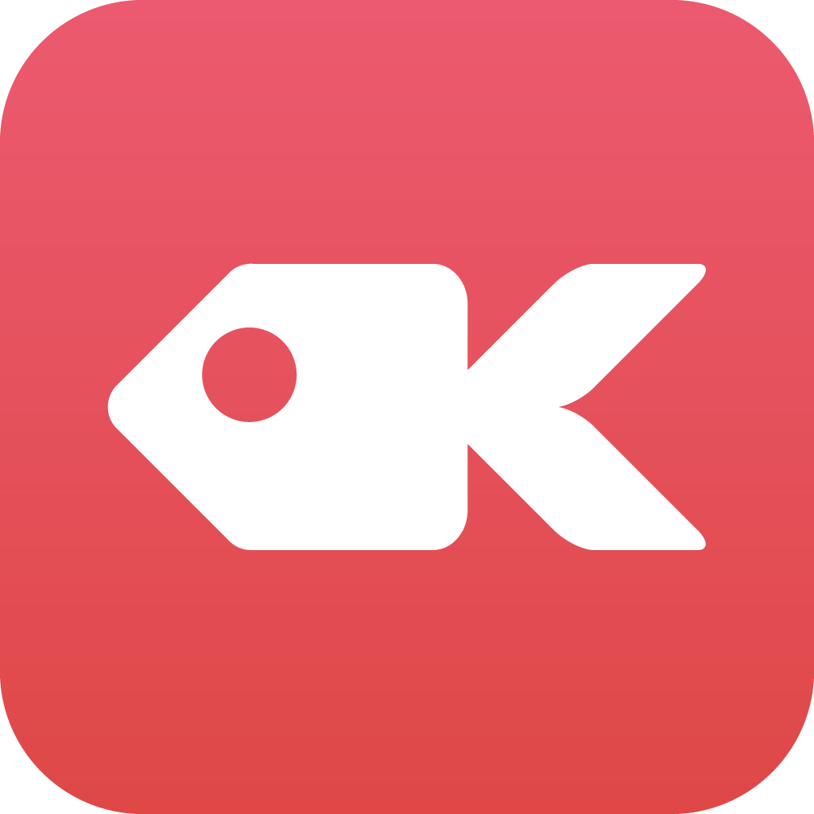
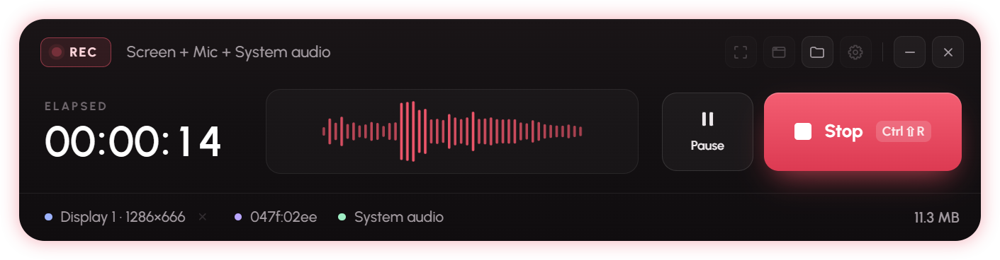
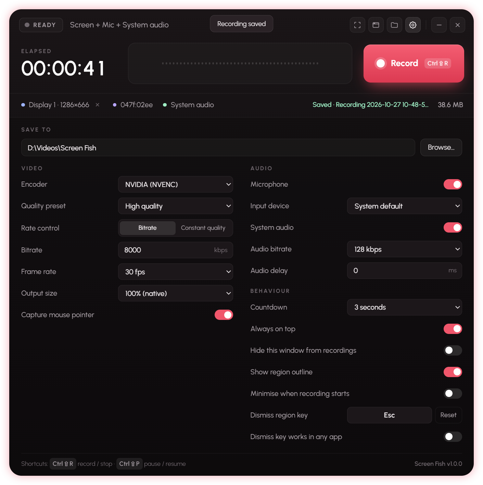

# Screen Fish

## Free Screen Recorder for Windows

A Windows 10/11 screen recorder app for any region you draw or window you select.

Records to MP4 (H.264 + AAC) with microphone and system audio. Both installer and portable versions available for download.

## About

Reliable screen capture has always been a pain point on Windows, even with many paid apps falling short. Rather than settle for another disappointing solution, I put Claude.ai to work building an app around a specific set of features I wanted.

This application is built on Electron.





## Downloads

See the [Releases](https://github.com/mikeott/Screen-Fish/releases).

## Requirements

- Windows 10 (version 2004 or later) or Windows 11, 64-bit.
- To build from source: [Node.js](https://nodejs.org/) (LTS).

Screen Fish is Windows-only. Builds for macOS or Linux will open but can't record.

## Run

```
npm install
npm start
```

## Build

```
npm run dist
```

Produces an installer (`Screen Fish Setup x.x.x.exe`) and a portable exe (`Screen Fish x.x.x.exe`) in `dist/`.

| Command | Output |
| --- | --- |
| `npm run dist` | Installer and portable exe |
| `npm run dist:portable` | Portable exe only |
| `npx electron-builder --win nsis` | Installer only |
| `npx electron-builder --win zip` | Zipped portable folder (starts faster than the single-file portable exe) |

The installer adds Start menu and desktop shortcuts and an uninstaller. The portable exe runs without installing, but unpacks itself on every launch so it starts a little slower. Both store settings in `%APPDATA%\Screen Fish`.

The version number comes from `package.json` and is shown at the bottom of the settings panel.

## Using it

- **Record** – if no region is set you'll be asked to draw one first. After the countdown (if enabled), recording starts. Clicking the button during the countdown cancels it.
- **Region** – the corner-brackets button draws a new region. Drag across any display, press `Enter` for the whole display, `Esc` or right-click to cancel. The last drawn region is remembered between launches.
- **Window** – the window button lets you hover over any open window and click it to record just that window (`Esc` cancels). When recording starts the window is brought to the front. If you move or resize it, the capture follows once it settles; resized windows are fitted into the original frame size. Closing the window stops and saves the recording. Picked windows aren't remembered between launches.
- **Pause / Resume / Stop** – buttons appear while recording.
- **Shortcuts** – `Ctrl+Shift+R` record/stop, `Ctrl+Shift+P` pause/resume (work from any app).
- **Folder button** – opens the recordings folder.
- **Cog button** – settings.
- **Footer** – shows the current region or window (click it to pick again, or × to dismiss it), the mic and system audio sources, and the file size while recording. After a recording is saved, click its name to show it in the folder, or double-click to open it.

Window recording captures the area of the screen where the window sits, so anything dragged over it during recording will also appear in the video.

## Settings

| Setting | Notes |
| --- | --- |
| Save to | Folder for finished MP4s. Defaults to `Videos\Screen Fish`. Files are named `Recording YYYY-MM-DD HH-MM-SS.mp4`. |
| Encoder | CPU (x264) works everywhere. NVENC / Quick Sync / AMF use the GPU and need matching hardware; you'll get an error on Record if it isn't available. |
| Quality preset | Encoder speed/quality trade-off. Higher presets use more CPU on x264. |
| Rate control | **Bitrate** = fixed kbps. **Constant quality** = CRF/CQ value, lower is better quality and bigger files. |
| Frame rate | 24 / 30 / 50 / 60 fps. |
| Output size | 100% (native), or downscale to 75% or 50%. |
| Capture mouse pointer | On/off. |
| Microphone | On/off. |
| Input device | Any Windows input device, or the system default. |
| System audio | Everything playing through your default output device. |
| Audio bitrate | 96 to 320 kbps AAC. |
| Audio delay | Shift audio in ms if it drifts against the video on your machine. |
| Countdown | None, 3 or 5 seconds before recording starts. |
| Always on top | Keeps the Screen Fish window above other apps at all times. |
| Hide this window from recordings | Excludes the Screen Fish window from captures. While recording, the window also stays on top so Stop is always reachable. |
| Show region outline | Outline drawn just outside the area being recorded, shown as soon as a region or window is picked: dashed when idle, solid red while recording, amber when paused. It is never captured. |
| Minimise when recording starts | Minimises Screen Fish when recording begins. It's restored when recording stops. |
| Dismiss region key | Clears the selected region and its outline. Defaults to Escape and works while Screen Fish is focused; click the key box and press any key or combination to change it. The × next to the region label does the same. |
| Dismiss key works in any app | Makes the dismiss key work from any app while a region is shown. With a single key like Escape, that key won't reach other apps until the region is dismissed, so a combination is safer. |

## How it works

- Video is captured by the bundled FFmpeg (`gdigrab`) at physical pixel coordinates, so display scaling and multi-monitor layouts are handled.
- Mic and system audio are captured and mixed in the app, then streamed to FFmpeg through a named pipe.
- Windows are found and tracked through a small PowerShell helper that uses the Win32 API.
- Pausing finishes the current segment; resuming starts a new one. Moving a recorded window also starts a new segment at the new position. On Stop the segments are joined into a single MP4 without re-encoding, then the temporary `.parts` folder is removed. If joining fails, the parts are kept so nothing is lost.

## Licence

Screen Fish bundles [FFmpeg](https://ffmpeg.org/) via `ffmpeg-static`, which is licensed under the GPL. If you distribute builds, include FFmpeg's licence and a link to its source.
